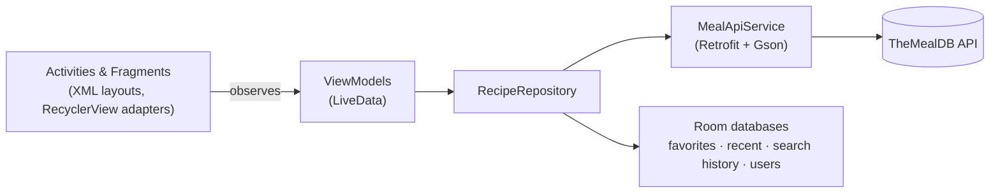

# Recipe Browser

An Android app for discovering, searching and saving recipes from [TheMealDB](https://www.themealdb.com/). Built in Kotlin with MVVM, Room and Retrofit by a four-person team during the ITI summer training program.

<!-- TODO: add 4 phone screenshots to docs/screenshots/ and keep the file names below -->
| Home | Details | Search | Favorites |
| :---: | :---: | :---: | :---: |
|  |  |  |  |

**[Download the APK](../../releases/latest)** · Android 7.0 (API 24) or newer

## Features

- **Accounts:** register and log in locally (Room), with the session remembered between launches.
- **Home:** a random featured meal, popular meals and recently viewed recipes.
- **Categories:** browse every TheMealDB category and the meals in it.
- **Search:** search meals by name, with a saved search history you can clear.
- **Recipe details:** ingredients, step-by-step instructions and the embedded YouTube video.
- **Favorites:** save recipes to a local Room database and view them offline.
- **Recently viewed:** a full list of the recipes you opened last.

## Architecture

The app follows MVVM. Fragments observe `LiveData` from ViewModels, and ViewModels go through a single repository that talks to both the network and the local database.



### Project structure

```
app/src/main/java/com/example/recipe_browser/
├── activities/     AuthActivity (login/register), MainActivity (app shell)
├── fragments/      Home, Category, Search, Details, Favorite, Recent, User, About, Splash, Login, Register
├── viewmodel/      One ViewModel per screen + ViewModelFactory
├── adapter/        RecyclerView adapters
├── repository/     RecipeRepository
├── network/        Retrofit service for TheMealDB
├── model/          API models and local Room entities/DAOs
└── room/           User database for authentication
```

## Tech stack

| Area | Libraries |
| --- | --- |
| Language | Kotlin |
| UI | XML layouts, Material Components, RecyclerView, Glide, android-youtube-player |
| Architecture | MVVM, ViewModel, LiveData, Kotlin coroutines |
| Networking | Retrofit, Gson converter, OkHttp logging interceptor |
| Storage | Room (KSP) |
| Build | Gradle Kotlin DSL, version catalog |

## Getting started

1. Clone the repo and open it in a recent Android Studio.
2. Let Gradle sync, then run the `app` configuration on an emulator or device.

From the command line:

```bash
./gradlew assembleDebug
# APK: app/build/outputs/apk/debug/app-debug.apk
```

No API key is needed; TheMealDB's public test key is used.

## Team

Built during the ITI summer training by:

<!-- TODO (Abdallah): fill in what each person owned. Be specific, e.g. "auth flow and Room user database". -->
| Member | Responsibilities |
| --- | --- |
| [Abdallah Momen](https://github.com/Abdallah1707) | TODO |
| Ahmed Bahaa | TODO |
| [Farid Ahmed](https://github.com/faridahmed44) | TODO |
| Abdelrahman Ashraf | TODO |

The team worked with feature branches and pull requests (see the branch history).
